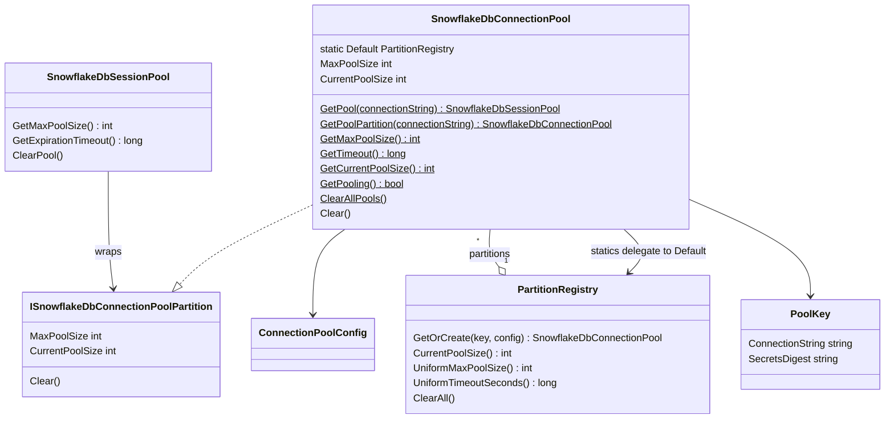
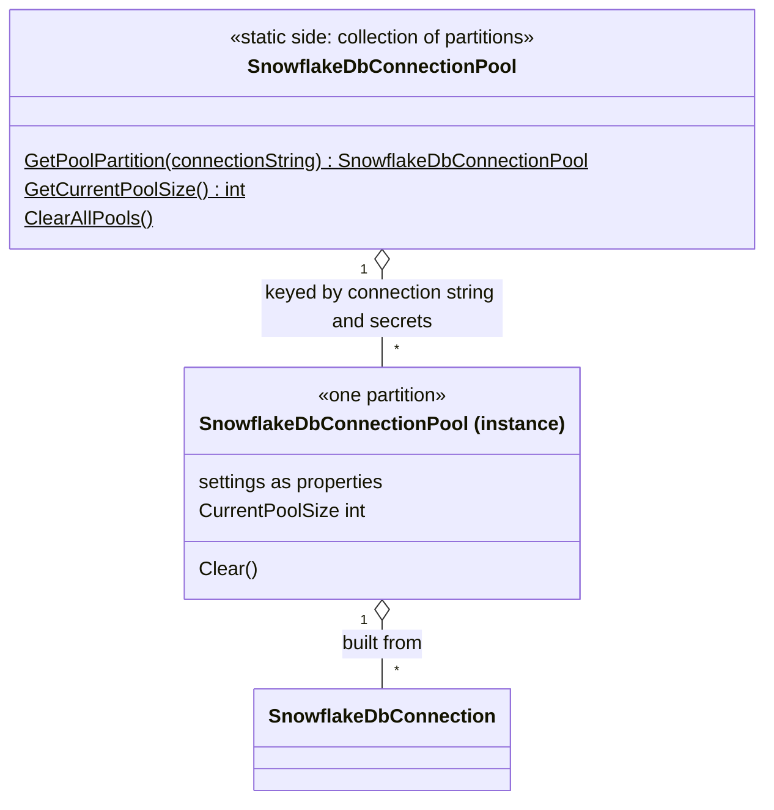

# .NET connection pool

The .NET wrapper exposes the connection pool API of the legacy .NET connector.
A session is not reused. This page records the shape of the API so later work
does not rediscover it.

## Where the pool lives

The pool is C# code in the .NET wrapper. `sf_core` has no pool: it creates and
closes one connection per `DatabaseHandle` / `ConnectionHandle` pair, and the
other wrappers do not share a pool implementation with it.

## Two roles on one class

`SnowflakeDbConnectionPool` in `Snowflake.Data.Client` is a non-static class with
no public constructor. It has a static side and one instance kind.

The static side is the partition manager. The static getters and lookups delegate to
`Default`, a `static readonly` `PartitionRegistry` nested in the class. The setters
throw, and `GetPooling()` returns true without reading `Default`. Tests
that need an isolated map construct `new SnowflakeDbConnectionPool.PartitionRegistry()`;
there is no settable static.

A partition instance is created by a registry when a key is first seen, through
`internal SnowflakeDbConnectionPool(PoolKey, ConnectionPoolConfig)`. Declaring
that constructor suppresses the public parameterless constructor the compiler
would otherwise generate. The legacy constructor produced an instance with no
members. `new SnowflakeDbConnectionPool()` does not compile. That break is
recorded in
`dotnet/behavior_differences/session/pool-public-constructor-removed.yaml`.

`PartitionRegistry`, `ISnowflakeDbConnectionPoolPartition`, `ConnectionPoolConfig`,
and `PoolKey` are internal. `ConnectionPoolConfig` is a sealed record.
`PoolKey` is a readonly record struct.

## Why pool partitions

The previous driver version introduced multiple pools on top of its existing
session pool, and each step added a class. `SnowflakeDbConnectionPool` forwards
to an `IConnectionManager` (`ConnectionPoolManager` for multiple pools,
`ConnectionCacheManager` for the single cache). The manager holds `SessionPool`
instances, and `SnowflakeDbSessionPool` wraps one `SessionPool` for callers.
The settings of one pool are answered at each of those layers.

This driver streamlines that API. The target public surface is two classes:

- `SnowflakeDbConnectionPool`: the keyed collection of partitions. Each partition
  is an instance of `SnowflakeDbConnectionPool`.
- `SnowflakeDbConnection`: the elements a partition is built from.

Everything else on the public surface is churn kept for upgrade and adoption,
not part of that design:

- `GetPool` and `SnowflakeDbSessionPool`, which repeat the partition under the
  names of the previous driver version.
- The static `Get*` and `Set*` methods for pool settings: `GetMaxPoolSize()`,
  `GetTimeout()`, `GetPooling()`, the setters that always throw, and the getters
  that take a connection string. Each one duplicates a partition property.

`GetPool` and `SnowflakeDbSessionPool` are `[Obsolete]`; the static `Get*` and
`Set*` methods are not.

TODO([SNOW-4628635](https://snowflakecomputing.atlassian.net/browse/SNOW-4628635)):
moving callers to partitions aligns the naming, but the migration may cost more
than it gains and slow adoption. The private and public preview release review
weighs this with the other behavior differences. If only a few remain, the
obsolescence is lifted; otherwise these members stay obsolete until a
breaking-change release removes them.

## Public surface

Callers use `SnowflakeDbConnectionPool` and `SnowflakeDbConnection`.

| Member | Class / kind | Legacy | New driver | Compatible |
| --- | --- | --- | --- | --- |
| Type | `SnowflakeDbConnectionPool`, public class | `Snowflake.Data.Client`, public parameterless constructor, no instance members | `Snowflake.Data.Client`, no public constructor, partition properties and `Clear()` | Constructor is breaking |
| `GetPool(string)` | static | Returns `SnowflakeDbSessionPool` | Obsolete warning; wraps the partition from `GetPoolPartition` | Source compatible, CS0618 |
| `GetPool(string, SecureString, SecureString, SecureString)` | static | Same, optional oauth client secret and token | Obsolete warning; same wrap | Source compatible, CS0618 |
| `GetPoolPartition(string)` and the secrets overload | static | Absent | Returns the partition, creating it on a miss | New |
| `ClearAllPools()` | static | Clears every pool | Clears every partition in `Default` | Yes |
| `SetMaxPoolSize` / `SetTimeout` / `SetPooling` | static | Throw `Exception` with the legacy message | Same message | Yes |
| `GetMaxPoolSize()` | static | Shared value, the default when no pools exist, otherwise `INCONSISTENT_RESULT_ERROR` | Same rule | Throws an exception whose type is not yet defined |
| `GetTimeout()` | static | Expiration in whole seconds, same aggregate rule | Same rule and the same seconds conversion | Throws an exception whose type is not yet defined |
| `GetCurrentPoolSize()` | static | Sum of every pool | Sum of every partition; 0 while no sessions exist | Yes |
| `GetPooling()` | static | `true` | `true`, including when a partition has pooling disabled | Yes |
| `GetPooling` / `GetMinPoolSize` / `GetMaxPoolSize` / `GetCurrentPoolSize` / `GetExpirationTimeout` / `GetConnectionTimeout` / `GetWaitForIdleSessionTimeout` / `GetChangedSession` / `ClearPool` | static, connection string plus optional secrets | Absent; the legacy connector uses `GetPool` | Forward to that partition. Timeouts are whole seconds | New |
| `MaxPoolSize`, `MinPoolSize`, `PoolingEnabled`, `ExpirationTimeout`, `ConnectionTimeout`, `WaitingForIdleSessionTimeout`, `ChangedSession` | instance properties | Absent | The partition's `ConnectionPoolConfig` | New |
| `CurrentPoolSize` | instance property | Absent | 0; no sessions are held | New |
| `Clear()` | instance method | Absent | Releases the partition's sessions. None are held, so this does nothing | New |
| `SetOldConnectionPoolVersion()` | static | Switches every connection to one shared cache | Absent | Breaking |
| `SnowflakeDbSessionPool` | public class | Instance methods over one pool, seconds for the timeouts | Obsolete. Forwards to `ISnowflakeDbConnectionPoolPartition` with the same seconds conversion | Source compatible, CS0618 |
| `SnowflakeDbConnection.PreventPooling()` | instance method | Throws `Exception` when no session exists; otherwise keeps the session out of the pool | Throws the same `Exception` when no session exists. After `Open` it does nothing. Keeping a session out of the pool is planned | Same failure when no session exists |

`GetPool` and `SnowflakeDbSessionPool` are `[Obsolete]` with
`IsError == false`. The message is "Use GetPoolPartition and its properties.
SnowflakeDbSessionPool will be removed in the next major version."
`ObsoleteAttribute.DiagnosticId` is not available on `net472`, so the warning is
CS0618 on every target. A build that treats warnings as errors fails until the
caller migrates or suppresses the warning. That difference is recorded in
`dotnet/behavior_differences/session/pool-get-pool-obsolete.yaml`.

Removing both `GetPool` overloads and `SnowflakeDbSessionPool` is planned for
the next major version. They are still present, and obsolete, because existing
callers compile against them. The partition stays on `SnowflakeDbConnectionPool`,
and `ISnowflakeDbConnectionPoolPartition` stays internal. Migration replaces
`GetPool(connectionString).GetMaxPoolSize()` with
`GetPoolPartition(connectionString).MaxPoolSize`, and the `long` seconds with
the `TimeSpan` properties.

The per-key static members and `GetPool` / `GetPoolPartition` take the connection
string, then optional `password`, `oauthClientSecret`, and `token`. A null
connection string throws `ArgumentNullException`. Lookup reads and validates the
pool keys below. It does not validate the rest of the string: a string that omits
`account` still selects a partition. The legacy `GetPool` parses the whole string
and throws `SnowflakeDbException` when a required property is missing, and
`GetPool(null)` throws `SnowflakeDbException` 270006 for the missing `ACCOUNT`.
That difference is recorded in
`dotnet/behavior_differences/session/pool-lookup-connection-string-not-validated.yaml`.
A null secret and an empty secret are both absent, so
`GetPoolPartition(connectionString)` selects the same partition as a call that
passes null or empty secrets.

`GetTimeout()` and `GetExpirationTimeout` are the session expiration timeout, in
whole seconds, not the connection timeout. `Timeout.InfiniteTimeSpan` is -1 for
expiration and for the connection timeout. The idle-session wait truncates
`TimeSpan.TotalSeconds` toward zero and does not map that infinite value to -1.

The setters (`SetMaxPoolSize`, `SetTimeout`, `SetPooling`) throw `Exception`
with the legacy message "You cannot change connection pool parameters for all
the pools. Instead you can change it on a particular pool".

## Aggregates

`GetCurrentPoolSize()` sums `CurrentPoolSize` across the partitions in the
registry. `GetMaxPoolSize()` and `GetTimeout()` return the default when the
registry is empty, the shared value when every partition agrees, and otherwise
the registry throws `SnowflakeDriverException` with `SFError.INCONSISTENT_RESULT_ERROR`
and "Multiple pools have different Max Pool Size values" or "Multiple pools have
different Timeout values". The public getters catch that carrier and throw
`ToPublicException()`. Differing values throw an exception whose type is not yet
defined. `GetTimeout()` compares the converted seconds, so two
expiration timeouts that truncate to the same whole second agree.
`GetPooling()` returns true and does not read the partitions.

`ClearAllPools()` removes each partition and then clears it, so a partition is
not dropped without `Clear()`. The registry takes no lock. A lookup that misses
parses the connection string and then adds the partition atomically, so
concurrent first lookups of one key may each parse and one partition is kept.
A failed parse registers nothing. A lookup that runs while `ClearAllPools()`
runs registers a new partition. A later lookup of a removed key creates a new
partition.
`Clear()` on a partition does not remove it from the registry.

## Pool keys

A partition is selected by a `PoolKey`: the connection string plus a digest of
the secrets.

| Component | Role |
| --- | --- |
| Connection string | Identifies the partition. Compared as given, so letter case is significant. |
| `password` | Optional secret. Null and empty are absent. |
| `oauthClientSecret` | Optional secret. Null and empty are absent. |
| `token` | Optional secret. Null and empty are absent. |

`PoolKeyFactory` builds the key. `PoolKey` holds the connection string and the digest.
The digest is HMAC-SHA256 with a per-process random key. Each secret is written
as a 4-byte big-endian length followed by its UTF-16 bytes, so the three slots
cannot be confused. A secret longer than `int.MaxValue / 2` characters is rejected
with `ArgumentOutOfRangeException`. The bytes are copied from unmanaged memory into a
pinned buffer, hashed, cleared, and the unmanaged memory is zeroed. When all three
secrets are absent the digest is null. Secret text is not stored on the key,
and `PoolKey.ToString()` returns the type name only.

A new partition reads these keys from the connection string through
`ConnectionStringParser`. The lookup is case-insensitive. A missing or empty
value uses the default. `ms`, `s`, and `m` name the timeout unit, and a timeout
with no unit is seconds. A negative expiration or connection timeout does not
elapse. A zero connection timeout does not elapse. A negative wait for an idle
session fails lookup. `MinPoolSize` above `MaxPoolSize` fails lookup. `MaxPoolSize`
must be positive and `MinPoolSize` must not be negative. `ChangedSession` is
`Destroy` or `OriginalPool`, ignoring case. The numbers `0` (`OriginalPool`) and
`1` (`Destroy`) are accepted. Any other number is rejected. `PoolingEnabled` is
a boolean.

`PoolingEnabled` defaults to false when the key is absent and the authenticator
is `externalbrowser`, `oauth_authorization_code`, or `snowflake_jwt` with
`PRIVATE_KEY_FILE` and no `PRIVATE_KEY_PWD`. Setting it to true for those
authenticators keeps pooling on and logs a warning. `oauth_authorization_code`
with pooling explicitly true and no `USER` fails lookup.

An invalid pool setting throws `SnowflakeDriverException` with
`SFError.INVALID_CONNECTION_STRING`. The message for a bad value names the key.
A connection string that cannot be parsed uses the same error and includes the
parser failure, which reports an index and does not include the connection
string. `GetPool`, `GetPoolPartition`, and the per-key statics convert that
carrier with `ToPublicException()`. The settings are parsed only when the key
is new. A failed parse registers nothing, and the next lookup parses again.

`ConnectionStringParser` still forwards every key to `sf_core`, including the
pool keys. `sf_core` reports a key that is not in its parameter registry as a
warning and does not fail the connection. The pool keys are not stripped.

`RETRY_TIMEOUT` defaults to 300 seconds. A positive value below 300 seconds is
raised to 300 seconds. Zero or a negative value does not elapse. A finite
connection timeout is then lowered to the retry timeout when that timeout is
finite and smaller, so `connection_timeout=600` with the default retry timeout
is 300 seconds, and `retry_timeout=0` leaves the connection timeout uncapped.
Checking a passcode against `MinPoolSize` is planned for session acquisition.

## The cache-pool variant is not ported

`SnowflakeDbConnectionPool.SetOldConnectionPoolVersion()` switches every
connection on the legacy connector to one shared cache. The new driver does
not provide that method, so only the per-connection-string pools exist. That
compile break is recorded in
`dotnet/behavior_differences/session/pool-cache-variant-not-ported.yaml`.

## What a partition does today

Opening and closing a `SnowflakeDbConnection` does not go through a partition.
Nothing reuses a session. `CurrentPoolSize` is 0. `Clear()` and `ClearAllPools()`
have no sessions to release. `PreventPooling()` still throws when no session
exists.

The configured defaults are the legacy multiple-pool defaults. They are not
enforced:

| Setting | Default |
| --- | --- |
| Minimum pool size | 2 |
| Maximum pool size | 10 |
| Changed session | `Destroy` |
| Wait for idle session timeout | 30 seconds |
| Expiration timeout | 60 minutes |
| Pooling enabled | true, or false for the authenticators above when the key is absent |
| Connection timeout | 300 seconds |

`GetTimeout()` returns that expiration timeout in whole seconds, 3600, when the
registry is empty.

Acquiring and releasing sessions, minimum and maximum enforcement, waiting for
an idle session, expiration, and changed-session handling are planned.
