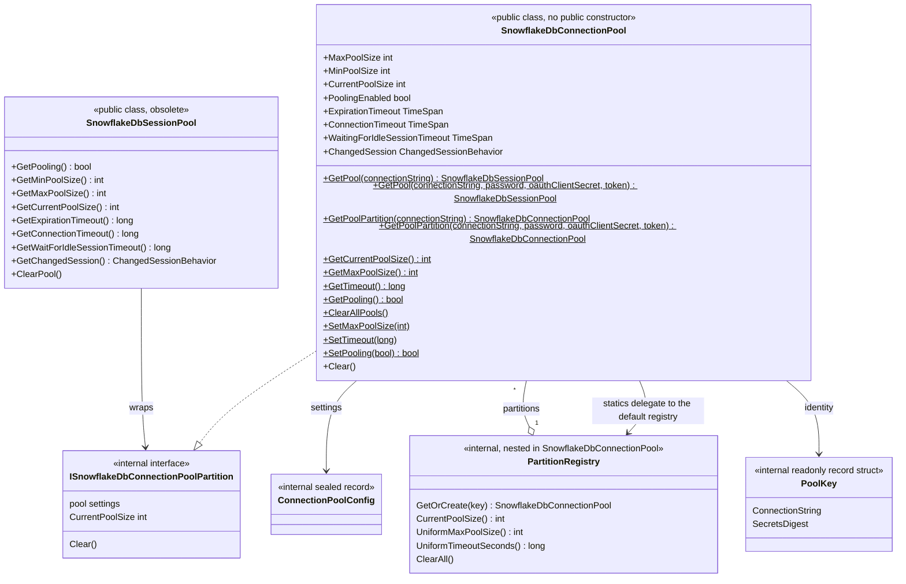

# Connection pooling

The connection pool is exposed through `SnowflakeDbConnectionPool` in
`Snowflake.Data.Client`. It keeps the pool API of the previous driver version
([snowflake-connector-net](https://github.com/snowflakedb/snowflake-connector-net)),
so code written against that version compiles unchanged, with the exceptions
listed in [Compared with the previous driver version](#compared-with-the-previous-driver-version).

## API

### Classes



| Class | Visibility | Responsibility |
| --- | --- | --- |
| `SnowflakeDbConnectionPool`, static members | public | Pool manager: looks up partitions, sums their sizes, answers the questions that span every partition, clears every partition. |
| `SnowflakeDbConnectionPool`, instance | public | One partition: its settings, its size, and `Clear()`. |
| `SnowflakeDbSessionPool` | public, obsolete | Wraps one partition behind the method names of the previous driver version. Holds no logic. |
| `ISnowflakeDbConnectionPoolPartition` | internal | Contract of one partition. |
| `SnowflakeDbConnectionPool.PartitionRegistry` | internal | Map from pool key to partition, create on first lookup, sum, uniform-value check, clear all. |
| `ConnectionPoolConfig` | internal | Settings of one partition. |
| `PoolKey` | internal | Identity of one partition: the connection string and a digest of the secrets. |

### One class, two roles

`SnowflakeDbConnectionPool` is the only class that manages pools.

The static members are the pool manager. They delegate to one process-wide
`PartitionRegistry`, created once and never replaced.

An instance is one partition: the pool for one connection string and one set of
secrets. Partitions are created by the registry the first time their key is
looked up, so the class has no public constructor. `GetPoolPartition` returns the
partition for a connection string, and its properties report that partition's
settings and size.

```csharp
var partition = SnowflakeDbConnectionPool.GetPoolPartition(connectionString);
int max = partition.MaxPoolSize;
TimeSpan expiration = partition.ExpirationTimeout;

int sessionsInEveryPool = SnowflakeDbConnectionPool.GetCurrentPoolSize();
```

### Pool identity

A partition is selected by the connection string, compared as given, together
with the optional `password`, `oauthClientSecret`, and `token`. A null secret and
an empty secret are the same. The secrets are kept only as a keyed digest, never
as text.

### Values that span every partition

| Static member | Result |
| --- | --- |
| `GetCurrentPoolSize()` | Sum of `CurrentPoolSize` over every partition. |
| `GetMaxPoolSize()` | The default when no partition exists, the shared value when every partition agrees, otherwise an `INCONSISTENT_RESULT_ERROR` error. |
| `GetTimeout()` | The expiration timeout in whole seconds, with the same rule as `GetMaxPoolSize()`. |
| `GetPooling()` | `true`. |
| `SetMaxPoolSize` / `SetTimeout` / `SetPooling` | Throw `Exception`: "You cannot change connection pool parameters for all the pools. Instead you can change it on a particular pool". |

## Compared with the previous driver version

| Member | Class / kind | Previous driver version | This driver | Compatible |
| --- | --- | --- | --- | --- |
| Namespace | `SnowflakeDbConnectionPool` | `Snowflake.Data.Client` | `Snowflake.Data.Client` | ✅ |
| Public parameterless constructor | `SnowflakeDbConnectionPool` | Compiler-generated; the instance has no members | None; instances are partitions created by the pool | ❌ Compile error |
| Subclassing | `SnowflakeDbConnectionPool` | Possible | No accessible constructor | ❌ Compile error |
| `GetPool(string)` | static | Returns `SnowflakeDbSessionPool` | Same; `[Obsolete]` | ⚠️ Warning CS0618 |
| `GetPool(string, SecureString, SecureString, SecureString)` | static | Same, optional OAuth client secret and token | Same; `[Obsolete]` | ⚠️ Warning CS0618 |
| `GetPoolPartition(string)` and the secrets overload | static | Absent | Returns the partition, creating it on first lookup | 🆕 |
| `ClearAllPools()` | static | Clears every pool | Clears every partition | ✅ |
| `SetMaxPoolSize` / `SetTimeout` / `SetPooling` | static | Throw `Exception` | Same message | ✅ |
| `GetMaxPoolSize()` / `GetTimeout()` | static | Shared value or `INCONSISTENT_RESULT_ERROR` | Same rule | ✅ |
| `GetCurrentPoolSize()` | static | Sum over every pool | Sum over every partition | ✅ |
| `GetPooling()` | static | `true` | `true` | ✅ |
| `GetPooling` / `GetMinPoolSize` / `GetMaxPoolSize` / `GetCurrentPoolSize` / `GetExpirationTimeout` / `GetConnectionTimeout` / `GetWaitForIdleSessionTimeout` / `GetChangedSession` / `ClearPool` with a connection string and optional secrets | static | Absent | Forward to that partition; timeouts in whole seconds | 🆕 |
| `MaxPoolSize`, `MinPoolSize`, `CurrentPoolSize`, `PoolingEnabled`, `ExpirationTimeout`, `ConnectionTimeout`, `WaitingForIdleSessionTimeout`, `ChangedSession` | instance properties | Absent | The partition's settings and size; timeouts as `TimeSpan` | 🆕 |
| `Clear()` | instance method | Absent | Clears the partition | 🆕 |
| `SetOldConnectionPoolVersion()` | static | Switches every connection to one shared connection cache | Removed | ❌ Compile error |
| `SnowflakeDbSessionPool` | public class | One pool's settings, timeouts in whole seconds | Same methods and conversions; `[Obsolete]` | ⚠️ Warning CS0618 |
| `PreventPooling()` | `SnowflakeDbConnection` | Throws `Exception` when no session exists | Same | ✅ |

The incompatible rows are recorded as behavior differences:

- [`pool-public-constructor-removed`](../behavior_differences/session/pool-public-constructor-removed.yaml)
- [`pool-get-pool-obsolete`](../behavior_differences/session/pool-get-pool-obsolete.yaml)
- [`pool-cache-variant-not-ported`](../behavior_differences/session/pool-cache-variant-not-ported.yaml)

The shared connection cache of `SetOldConnectionPoolVersion()` is removed, not
kept as a method that would fail at run time, so code that depends on it stops
at compile time.

## Migrating from SnowflakeDbSessionPool

`GetPool` and `SnowflakeDbSessionPool` are `[Obsolete]` as a warning, with the
message "Use GetPoolPartition and its properties. SnowflakeDbSessionPool will be
removed in the next major version." `ObsoleteAttribute.DiagnosticId` is not
available on .NET Framework, so the warning is CS0618 on every target. A build
that treats warnings as errors fails until the code migrates or suppresses CS0618.

Removing both `GetPool` overloads and `SnowflakeDbSessionPool` is planned for the
next major version. Nothing else depends on them: the partition is
`SnowflakeDbConnectionPool` itself.

| Previous driver version | This driver |
| --- | --- |
| `GetPool(cs).GetMaxPoolSize()` | `GetPoolPartition(cs).MaxPoolSize` |
| `GetPool(cs).GetMinPoolSize()` | `GetPoolPartition(cs).MinPoolSize` |
| `GetPool(cs).GetCurrentPoolSize()` | `GetPoolPartition(cs).CurrentPoolSize` |
| `GetPool(cs).GetPooling()` | `GetPoolPartition(cs).PoolingEnabled` |
| `GetPool(cs).GetExpirationTimeout()` (seconds) | `GetPoolPartition(cs).ExpirationTimeout` (`TimeSpan`) |
| `GetPool(cs).GetConnectionTimeout()` (seconds) | `GetPoolPartition(cs).ConnectionTimeout` (`TimeSpan`) |
| `GetPool(cs).GetWaitForIdleSessionTimeout()` (seconds) | `GetPoolPartition(cs).WaitingForIdleSessionTimeout` (`TimeSpan`) |
| `GetPool(cs).GetChangedSession()` | `GetPoolPartition(cs).ChangedSession` |
| `GetPool(cs).ClearPool()` | `GetPoolPartition(cs).Clear()` |
| `GetPool(cs, password)` | `GetPoolPartition(cs, password)` |
